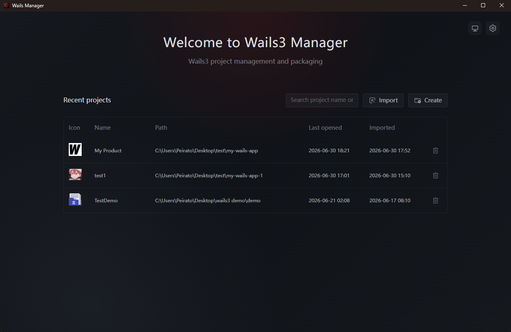

<div align="center">


# Wails3 Manager

Desktop UI for creating, configuring, building, and packaging Wails 3 apps.


**English** · [简体中文](introduce/README.zh-CN.md) · [繁體中文](introduce/README.zh-TW.md) · [日本語](introduce/README.ja-JP.md) · [한국어](introduce/README.ko-KR.md) · [Français](introduce/README.fr-FR.md) · [Deutsch](introduce/README.de-DE.md) · [Русский](introduce/README.ru-RU.md)

</div>

> [!IMPORTANT]
> Wails3 Manager targets Wails 3 beta.28. Windows installers are compiled on Windows, and macOS DMGs are created on macOS.

<picture>
  <source media="(prefers-color-scheme: dark)" srcset="imgs/english/dark/home.png">
  <source media="(prefers-color-scheme: light)" srcset="imgs/english/light/home.png">
  
</picture>

## What It Helps With

Wails3 Manager puts common Wails project work in one window. You can create or import a project, edit app information and icons, prepare build settings, make native packages, check the local toolchain, and watch build logs.

The convenience is simple: less switching between terminals, config files, icon tools, and installer scripts. The manager writes the related project files, runs the needed commands, and keeps package outputs together.

## Download

1. Download the build for your OS from [Releases](https://github.com/Peiratooo/Wails3-Manager/releases).
2. Start Wails3 Manager and check the environment page.
3. Create a new Wails 3 project or import an existing one.
4. Configure, build, and package from the workspace.

Native packaging needs **Inno Setup** on Windows and the Wails CLI plus macOS disk-image and signing tools on macOS.

DMG packaging offers two modes: the official Wails standard layout and a custom layout with draggable icons. Existing configurations keep their custom layout; newly initialized configurations default to official mode. Optional volume and DMG file icons are configured separately.

Application bundles are copied into a temporary staging directory before packaging. New or modified bundles receive an ad-hoc signature; unchanged prebuilt bundles retain their signatures. Developer ID signing and notarization remain separate distribution steps. A previous DMG is replaced only after a non-empty new output has been produced.

## Features

Main functions:

- Create projects from official, local, or remote Wails templates, then open them in the manager.
- Import existing Wails 3 projects and keep a recent-project list.
- Edit product metadata and replace the app icon; PNG icons are converted into Wails platform assets.
- Configure build name, production mode, CGO, launch program, and bundled files.
- Generate Windows Inno Setup installers and macOS DMG packages on the matching OS.
- Check Go, Node.js, npm, Wails3 CLI, Git, and packaging tools before building.
- Show live build logs and collect final outputs in `builder/release`.

## Screenshots

<table>
<tr>
<td width="50%" valign="top"><strong>Project creation</strong><br><br></td>
<td width="50%" valign="top"><strong>Project metadata</strong><br><br></td>
</tr>
<tr>
<td width="50%" valign="top"><strong>Build and packaging</strong><br><br></td>
<td width="50%" valign="top"><strong>Environment check</strong><br><br></td>
</tr>
</table>

## Development

Stack: Wails 3, Go, Vue 3, Vite, Naive UI, Pinia, Vue Router, Vue I18n, vue3-moveable.

Requirements:

- Go **1.27.3** (as declared in go.mod)
- Wails3 CLI **v3.0.0-beta.28**, matching the Go module and frontend runtime
- Node.js **22.12+** and npm
- Wails platform toolchain for your OS
- macOS 13 Ventura or later for builds made with Go 1.27

```bash
git clone --branch 1.1.0 https://github.com/Peiratooo/Wails3-Manager.git wails3-manager
cd wails3-manager
go install github.com/wailsapp/wails/v3/cmd/wails3@v3.0.0-beta.28
cd frontend
npm ci
cd ..
wails3 task dev
```

Useful commands:

```bash
cd frontend
npm run i18n:check
npm run build
cd ..
go vet ./...
wails3 task build
wails3 task release
wails3 task package
```

On macOS, use `wails3 task darwin:package:universal:dmg` to build an Intel + Apple Silicon DMG. For public distribution, run `darwin:package:universal`, then `darwin:sign:notarize`, then `darwin:create:dmg`. Signing uses the existing bundle without rebuilding it, and `create:dmg` preserves that signed bundle. Native-only packages use `darwin:package` instead of `darwin:package:universal`.

## Managed Project Files

Imported projects get a manager-owned `builder/` directory:

```text
builder/
├── project.json
├── packaging.json
├── backup/initial/
├── windows/inno.iss
├── macos/dmg-background.png
└── release/
```

## Current Limits

- Wails 3 is in beta; its APIs may change.
- Native packages must be created on the target OS.
- Linux packaging is not implemented.
- The manager UI does not handle Developer ID signing or notarization. Use the CLI distribution steps above; newly created or modified bundles receive an ad-hoc signature.
- Automatic publishing, cancellation, and versioned build history are not implemented.

## License

Licensed under the [Apache License 2.0](LICENSE).
