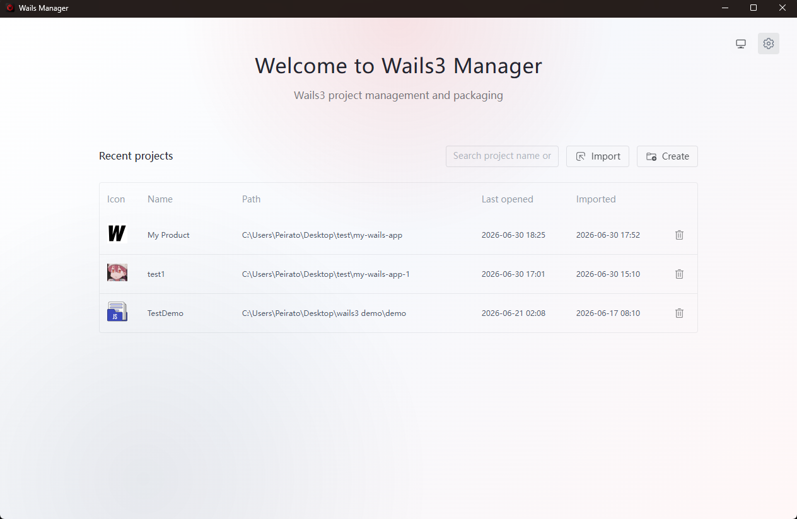
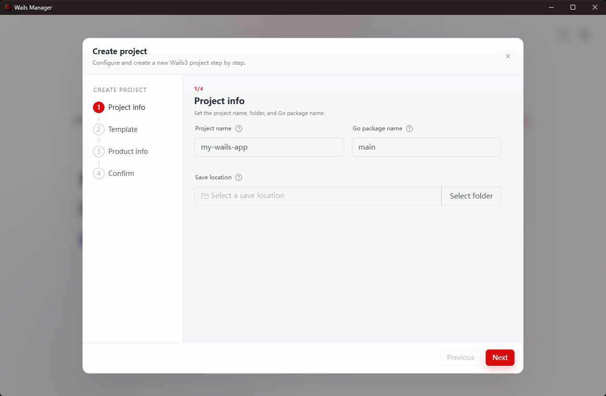
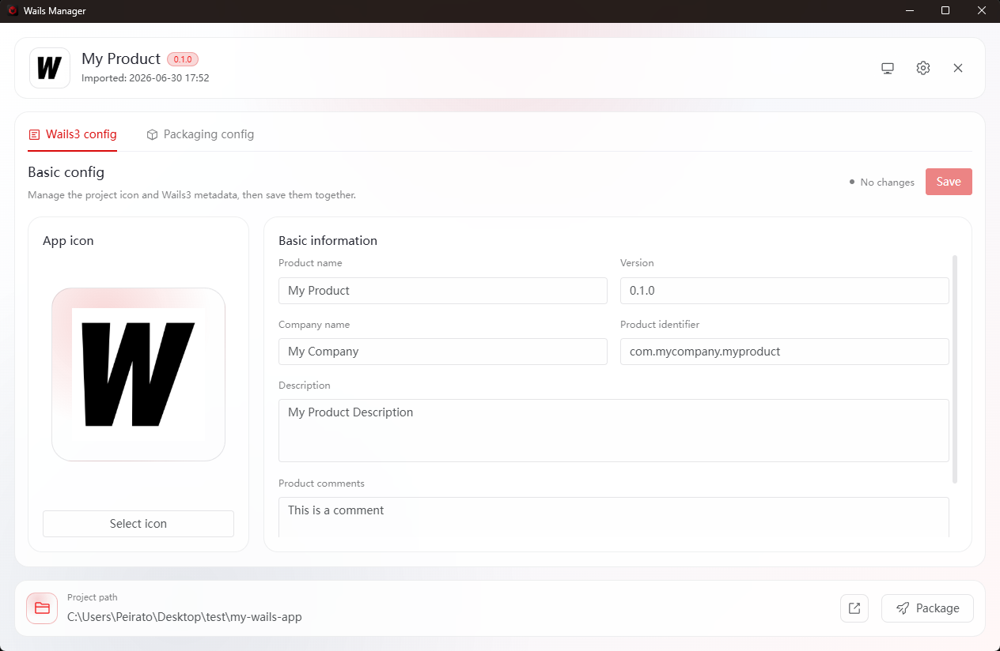
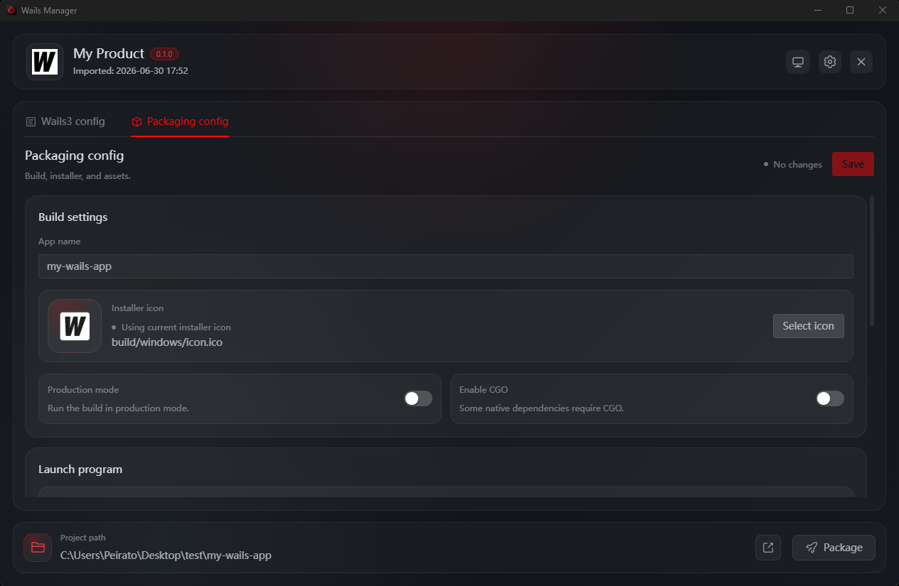
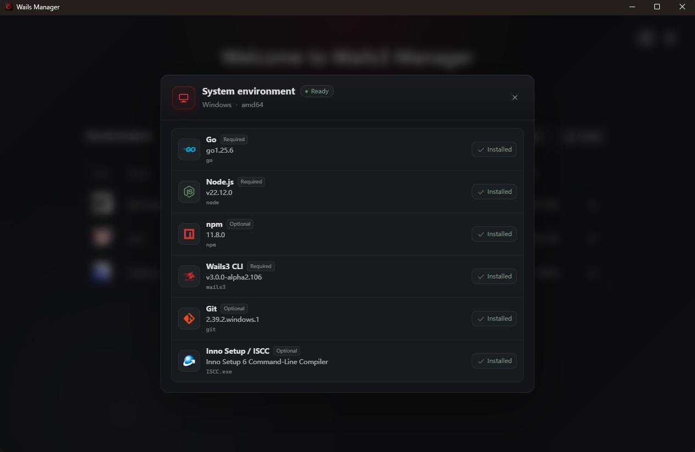

<div align="center">


# Wails3 Manager

Desktop-UI zum Erstellen, Konfigurieren, Bauen und Paketieren von Wails-3-Apps.


[English](../README.md) · [简体中文](README.zh-CN.md) · [繁體中文](README.zh-TW.md) · [日本語](README.ja-JP.md) · [한국어](README.ko-KR.md) · [Français](README.fr-FR.md) · **Deutsch** · [Русский](README.ru-RU.md)

</div>

> [!IMPORTANT]
> Wails3 Manager verwendet Wails 3 beta.28. Windows-Installer werden unter Windows kompiliert, macOS-DMGs unter macOS erstellt.

<picture>
  <source media="(prefers-color-scheme: dark)" srcset="../imgs/english/dark/home.png">
  <source media="(prefers-color-scheme: light)" srcset="../imgs/english/light/home.png">
  
</picture>

## Wobei Es Hilft

Wails3 Manager bündelt häufige Wails-Projektarbeit in einem Fenster. Du kannst Projekte erstellen oder importieren, App-Daten und Icons bearbeiten, Build-Einstellungen vorbereiten, native Pakete erzeugen, lokale Werkzeuge prüfen und Build-Logs ansehen.

Der Vorteil ist schlicht: weniger Wechsel zwischen Terminal, Konfigurationsdateien, Icon-Werkzeugen und Installer-Skripten. Der Manager schreibt die passenden Projektdateien, führt die nötigen Befehle aus und sammelt Paket-Ausgaben an einem Ort.

## Download


1. Den Build für das eigene Betriebssystem unter [Releases](https://github.com/Peiratooo/Wails3-Manager/releases) herunterladen.
2. Wails3 Manager starten und die Umgebungsseite prüfen.
3. Neues Wails-3-Projekt erstellen oder vorhandenes Projekt importieren.
4. Im Arbeitsbereich konfigurieren, bauen und paketieren.

Native Pakete benötigen **Inno Setup** unter Windows sowie die Wails-CLI und macOS-Werkzeuge für Datenträgerabbilder und Signaturen.

DMGs unterstützen das offizielle Standardlayout und ein eigenes Layout mit verschiebbaren Symbolen. Neue Konfigurationen verwenden den offiziellen Modus. Hintergrund, Volume-Symbol und DMG-Dateisymbol werden getrennt eingestellt; ohne ausgewählten Hintergrund wird das integrierte Rasterbild verwendet.

App-Bundles werden vor dem Paketieren in ein temporäres Verzeichnis kopiert. Neue oder geänderte Bundles erhalten eine Ad-hoc-Signatur, unveränderte vorgefertigte Bundles behalten ihre Signatur. Developer-ID-Signierung und Notarisierung sind separate Veröffentlichungsschritte. Ein vorhandenes DMG wird erst durch eine erfolgreich erzeugte, nicht leere Datei ersetzt.

## Funktionen

Hauptfunktionen:

- Projekte aus offiziellen, lokalen oder entfernten Wails-Templates erstellen und im Manager öffnen.
- Vorhandene Wails-3-Projekte importieren und eine Liste zuletzt verwendeter Projekte behalten.
- Produktdaten bearbeiten und das App-Icon ersetzen; PNGs werden in Wails-Plattformressourcen umgewandelt.
- Build-Name, Produktionsmodus, CGO, Startprogramm und mitgelieferte Dateien konfigurieren.
- Windows-Inno-Setup-Installer und macOS-DMGs auf dem passenden OS erzeugen.
- Go, Node.js, npm, Wails3 CLI, Git und Paketierungswerkzeuge vor dem Build prüfen.
- Build-Logs anzeigen und finale Ausgaben in `builder/release` sammeln.

## Screenshots

<table>
<tr>
<td width="50%" valign="top"><strong>Project creation</strong><br><br></td>
<td width="50%" valign="top"><strong>Project metadata</strong><br><br></td>
</tr>
<tr>
<td width="50%" valign="top"><strong>Build and packaging</strong><br><br></td>
<td width="50%" valign="top"><strong>Environment check</strong><br><br></td>
</tr>
</table>

## Entwicklung

Stack: Wails 3, Go, Vue 3, Vite, Naive UI, Pinia, Vue Router, Vue I18n, vue3-moveable.

Voraussetzungen:

- Go **1.27.3**
- Wails3 CLI kompatibel mit `github.com/wailsapp/wails/v3 v3.0.0-beta.28`
- Node.js **22.12+** und npm
- macOS 13 Ventura oder neuer für mit Go 1.27 erstellte Apps
- Wails-Plattform-Toolchain für das eigene OS

```bash
git clone --branch 1.1.0 https://github.com/Peiratooo/Wails3-Manager.git wails3-manager
cd wails3-manager
go install github.com/wailsapp/wails/v3/cmd/wails3@v3.0.0-beta.28
cd frontend
npm ci
cd ..
wails3 task dev
```

Nützliche Befehle:

```bash
cd frontend
npm run i18n:check
npm run build
cd ..
go vet ./...
wails3 task build
wails3 task release
wails3 task package
```

Unter macOS erstellt `wails3 task darwin:package:universal:dmg` ein DMG für Intel und Apple Silicon. Für die öffentliche Verteilung führe nacheinander `darwin:package:universal`, `darwin:sign:notarize` und `darwin:create:dmg` aus. Die Signierung verwendet das vorhandene Bundle ohne Neubau. Für nur eine native Architektur ersetze `darwin:package:universal` durch `darwin:package`.

## Verwaltete Projektdateien

Importierte Projekte erhalten ein `builder/`-Verzeichnis:

```text
builder/
├── project.json
├── packaging.json
├── backup/initial/
├── windows/inno.iss
├── macos/dmg-background.png
└── release/
```

## Aktuelle Grenzen

- Wails 3 ist in der Beta-Phase; die APIs können sich ändern.
- Native Pakete müssen auf dem Ziel-OS erstellt werden.
- Linux-Paketierung ist nicht implementiert.
- Die Manager-Oberfläche übernimmt keine Developer-ID-Signierung oder Notarisierung. Verwende dafür die oben beschriebenen CLI-Schritte; neue oder geänderte Bundles werden ad hoc signiert.
- Automatische Veröffentlichung, Abbruch und versionierter Build-Verlauf sind nicht implementiert.


## Lizenz

Lizenziert unter der [Apache License 2.0](../LICENSE).
